# Personalized News App: Design & Architecture

Nov 19, 2026

## Summary

Build a personalized newspaper around **stories, not articles**: cluster every incoming article into an event, rank events per reader, and let an LLM write short, cited briefings on top. That one choice makes deduplication, multi-source comparison, digests and "what changed" updates all fall out of the same data model.

Recommended decisions at a glance:

| Area | Recommendation | Main trade-off |
| --- | --- | --- |
| Launch scope | English only (US, UK, Canada, Australia, Ireland, India); web app first, mobile second | Smaller audience at launch, much less to build and moderate |
| Business model | Free trial (14 days), then a subscription | Needs value fast in the trial; no ad-driven incentive to chase clicks |
| Sources | A curated allowlist of reputable outlets via RSS, plus one aggregator API for breadth | Curation takes ongoing effort, but quality and trust are the product |
| Source quality | Reliability tiers, opinion pieces kept out of summaries, every summary built from outlets across the spectrum | Fewer sources per story, but more neutral output |
| Content rights | Show headline, short snippet, AI summary of facts, and link out; never republish full articles | Less "stay in app" time, far lower legal risk |
| Core data model | Article → Story (event cluster) → Topic/Entity | Clustering adds a pipeline stage but removes duplicate noise |
| Personalization | Explicit interests + followed sources first, then a hybrid content/behaviour ranker that also weights source reliability | Learning takes a few weeks of signals |
| LLM use | Summaries per story, generated once and shared, then checked by a separate verifier before anyone sees them | Verification adds cost and a few minutes of delay |
| Stack (solo builder) | Next.js web app, Supabase (Postgres + pgvector + auth), Python workers, Claude API | Managed services cost a little more but save ops time |
| Budget | Lean tier (about $50–100 a month) while building, Balanced tier (about $300–600 a month) from beta | See Budget options |
| Launch | Web MVP in about 12 weeks; mobile app after the web product proves retention | Mobile users wait longer |

## Product ideas

The product promise is "your own front page, written for you, from sources you trust." Ship the first five features below as the MVP; the rest earn their place once people use it daily.

| Feature | What the reader gets | Phase |
| --- | --- | --- |
| Interests and sources | Pick topics, people, companies, places and favourite outlets; mute what you dislike | MVP |
| Personal front page | A ranked feed of stories (not duplicate articles), each showing how many outlets cover it | MVP |
| Story page | One AI summary of the event, the timeline so far, and links to every outlet's version | MVP |
| Daily digest | A 3–5 minute briefing each morning: top stories for you plus 1–2 "everyone should know" items | MVP |
| Feedback controls | More like this, less like this, hide source, follow topic, save for later | MVP |
| Recommendations | "Because you read X", rising stories in your topics, new sources worth trying | Phase 2 |
| "What changed" updates | When a story you read develops, a short delta instead of a fresh article | Phase 2 |
| Perspective view | Side by side framing from outlets across regions or the political spectrum | Phase 2 |
| Ask the news | Chat over recent coverage: "What happened with the EU AI Act this week?" with citations | Phase 2 |
| Audio digest | The daily briefing read aloud by text-to-speech for commutes | Phase 3 |
| Breaking alerts | Push only for high-importance stories that match strong interests, with a daily cap | Phase 3 |
| Weekly deep dive | A longer weekend recap per followed topic | Phase 3 |

Three ideas differentiate it from existing aggregators: the story-level view with source count, the "what changed since you last read" delta, and full control over sources, which builds trust.

**Business model: free trial, then subscription.** Give full access for 14 days, with no ads. The trial has to show value quickly: onboarding sets up interests, and the first daily digest arrives the next morning. After the trial, readers subscribe (monthly or yearly). A subscription also fits the trust promise, because the app earns money from readers rather than from clicks. Track trial-to-paid conversion and digest open rate as the two main business metrics.

## UX design

The app has four screens and one rule: every summary links to its sources within one tap, so readers can always check the AI.

1. **Onboarding (under 60 seconds).** Pick 5+ topics from tappable chips, optionally pick favourite outlets, choose digest time and length. Skip is allowed; the feed then starts from popular stories and learns.
2. **Front page.** A vertical list of story cards in sections: "Top for you", one section per strong interest, and "Also important today".
   - Card: headline, 2-line summary, outlet logos with a "+7 sources" count, age, topic tag.
   - Long-press or a small menu: more like this, less like this, hide source, mute topic.
3. **Story page.** AI summary (3–5 bullet facts with citation markers), a short timeline of earlier developments, then the list of original articles. Opening an article goes to the publisher in an in-app browser.
4. **Digest.** Delivered as push notification and email at the chosen time. Opens a scrollable briefing grouped by theme, with "read more" into each story page and a "listen" button later.
5. **My News (settings).** Interests, sources, muted items, digest schedule, and a "Why am I seeing this?" view that lists the signals behind each recommendation.

Design principles:

- **Calm, finite feed.** Show "You're caught up" after the day's stories instead of an endless scroll. This is a strong selling point against social feeds.
- **Transparency.** Label AI-written text, show source counts, and explain recommendations.
- **Control beats magic.** Explicit settings always override learned preferences.
- **Accessibility.** Dynamic type, dark mode, screen-reader labels on cards, and text-to-speech.

## News source strategy

Use publisher RSS/Atom feeds as the backbone, add one commercial aggregator API for breadth and search, and treat full-text licensing as a later business deal, not an MVP requirement. Pricing and terms below are from general knowledge and change often, so verify them before committing.

| Source type | Examples | Gives you | Cost | Licensing notes |
| --- | --- | --- | --- | --- |
| Publisher RSS/Atom | Most major outlets, blogs, Substack, Google News topic feeds | Headline, snippet, link, date, sometimes image | Free | Feeds are meant for syndication of links; respect each site's terms and robots rules |
| News aggregator APIs | NewsAPI.org, GNews, NewsData.io, Mediastack, Event Registry (NewsAPI.ai) | Normalized metadata, search, categories, some text | Free dev tiers; production plans roughly tens to hundreds of USD per month | Free tiers often forbid production use; full text usually not included |
| Event / knowledge datasets | GDELT | Global events, entities, tone, links | Free | Good for importance signals and coverage counts, not for display text |
| Wire and licensed feeds | AP, Reuters, AFP licensing | Full text, photos, display rights | Enterprise contracts | The only clean route to full text in app; consider once there is traction |
| Social and community | Reddit, Hacker News, Bluesky | Trending signals, discussion links | Free to low | Use as ranking signals, not as news content |
| User-added feeds | Any RSS URL a reader pastes | Long-tail sources | Free | Readers' choice; still show only snippets and links |

Rules for staying on the right side of copyright:

- Display headline, a short snippet, the outlet name and a link. Do not store or show full article text you have no licence for.
- Generate summaries from the facts across many outlets' snippets and metadata, and always link to the originals. Be careful with paywalled content: do not bypass paywalls or scrape full text against site terms.
- Keep a source registry with per-source rules: allowed fields, attribution format, image rights, crawl rate.
- Plan for publisher partnerships (revenue share or referral traffic) as the scale path. Some outlets actively negotiate AI licensing deals now; others litigate.
- Get a short legal review before launch, especially for the EU (copyright directive, press publishers' rights) if you serve European users.

Recommended start: about 200–300 curated English-language feeds (US, UK, Canada, Australia, Ireland, India) across 15–20 topics, plus one aggregator plan for search and gaps, plus GDELT for importance signals.

### Favouring reputable, unbiased sources

No outlet is perfectly neutral, so aim for two things: only reputable outlets feed the AI summaries, and every summary is balanced across outlets with different leanings. Each source in the registry gets a reliability tier and a lean label, reviewed by you every quarter.

| Tier | Who | How it is used |
| --- | --- | --- |
| 1. Fact base | Wire services (AP, Reuters, AFP), public broadcasters (BBC, NPR, PBS, CBC, ABC Australia) | Preferred source of facts for every summary; strongest ranking boost |
| 2. Reputable outlets | Papers of record and major outlets (for example The New York Times, The Wall Street Journal, The Washington Post, The Guardian, The Times, Financial Times, The Economist, Bloomberg), plus respected specialist and regional titles | Used in summaries and ranking |
| 3. Other or user-added | Anything a reader adds, or outlets with weaker records | Shown in the reader's own feed with a label; never used to write summaries |
| Excluded | Sites with repeated fabrications, content farms, state propaganda outlets | Not ingested |

How tiers and lean labels are set:

- **Inputs:** published third-party ratings such as Ad Fontes Media (reliability and bias), AllSides (lean) and NewsGuard (credibility scores, needs a commercial licence), plus your own checks: a visible corrections policy, named authors, clear ownership, and news kept separate from opinion. Check each provider's licence before storing or showing its ratings in the app.
- **Opinion stays out:** detect opinion, editorials and sponsored content from feed categories, URL patterns (such as /opinion/) and an LLM label. Show them labelled as opinion, but never use them as facts in a summary.
- **Balance rule:** a story summary needs at least 3 Tier 1–2 outlets, including at least one wire service or public broadcaster and outlets from at least two different lean groups. Stories that miss the rule show headlines and links only until coverage grows.
- **Ranking:** a source reliability score is part of the ranking formula, and no single outlet may hold more than 2 of the top 10 cards.
- **Transparency:** each story page shows which outlets were used and their lean labels, so readers can judge the balance themselves.

## System architecture

Run an event-driven pipeline that turns raw feed items into enriched, clustered stories, and a separate serving layer that ranks those stories per reader. The two halves share one Postgres database with pgvector (hosted on Supabase), which is enough well past 100,000 readers.

```mermaid
flowchart LR
  A[News sources: RSS feeds, aggregator API, GDELT, social signals] --> B[Ingestion workers: poll feeds, dedup]
  B --> C[Job queue: Postgres queue pgmq]
  C --> D[Enrichment: topics, entities, embeddings, importance]
  D --> E[Story clustering: group articles into events]
  E --> F[LLM summarizer: cited summaries, what-changed deltas]
  F --> G[(Supabase Postgres + pgvector)]
  G --> H[Ranking service: candidates, scoring, diversity]
  H --> I[API and digest jobs]
  I --> J[Reader apps: web first, iOS and Android next, email and push]
  J -- reading signals --> G
```



Articles flow left to right and down: ingested, queued, enriched, grouped into stories, summarized, then stored; the ranking service reads stories and reader profiles, and reading signals flow back into the database.

Stack for a solo builder, web first. The rule is to rent managed services for everything that is not the product, so your time goes into sources, ranking and summary quality.

| Component | Recommended choice | Alternative | Why |
| --- | --- | --- | --- |
| Web app (launch) | Next.js (React) on Vercel, as a responsive site that also works as a PWA on phones | Remix, SvelteKit | Fast to build, good SEO for public story pages |
| Mobile app (second) | React Native with Expo, reusing the same API and much of the logic | Flutter | Shares the TypeScript and React skills from the web app |
| Database, auth, storage | Supabase: Postgres with pgvector, built-in auth (email, Google, Apple), row-level security | Neon + Clerk | One managed service replaces four; no servers to run |
| Pipeline workers | Python workers (feed polling, enrichment, clustering, summaries) on Railway, Render or Fly.io, scheduled with cron plus a simple queue | Supabase Edge Functions for small jobs | Python has the best feed, NLP and ML libraries |
| Queue and cache | Postgres-based queue (for example pgmq in Supabase) at first; Redis (Upstash) when needed | SQS | One less service to run in v1 |
| Search | Postgres full-text search | Typesense later | Avoid a second datastore until needed |
| Embeddings | A hosted embedding API (for example Voyage AI) or a small open model run in the workers |  | Needed for clustering and recommendations |
| LLM | Claude API: Claude Haiku 5.5 for volume work, Claude Sonnet 5.5 for summaries and verification | Other hosted models | Strong summarisation and structured output |
| Payments and trial | Stripe subscriptions with a 14-day trial | Paddle, Lemon Squeezy (handle sales tax for you) | Trials and billing work out of the box |
| Email digest and push | Resend or Postmark for email; web push now, Firebase/APNs with the mobile app |  | Digest delivery |
| Monitoring | Sentry for errors, PostHog for product analytics |  | Free tiers cover the early stage |

Key design details:

- **Story clustering:** embed each new article and compare it to stories active in the last 72 hours; join the nearest story above a similarity threshold, also matching shared entities and time window, else start a new story. Re-cluster nightly to merge splits.
- **Data model:** `sources`, `articles`, `stories`, `story_articles`, `entities`, `users`, `user_interests`, `events` (impressions, reads, feedback), `digests`.
- **Freshness:** poll popular feeds every 5–15 minutes and long-tail feeds hourly, using ETag and Last-Modified headers to save bandwidth.
- **Serving:** precompute each active reader's front page every 15–30 minutes and store it in a cache table; recompute on feedback. Digests are built in a batch job before each time-zone slot.
- **Observability:** feed health dashboard, pipeline lag, summary error reports, and LLM cost per day.

## Personalization and recommendations

Rank stories with a two-stage system: cheap candidate generation, then a scoring step that blends personal relevance with importance, freshness and diversity. Start with a hand-tuned formula and move to a learned model once there are a few weeks of interaction data.

**Reader profile.** Each reader has explicit interests (topics, entities, sources, mutes), an interest embedding built from what they read, and per-topic affinity scores that decay over time (half-life around 14 days) so tastes can change.

**Signals, strongest to weakest:**

| Signal | Weight direction | Notes |
| --- | --- | --- |
| Follow / mute topic or source | Hard rule | Mutes always filter; follows always boost |
| More / less like this | Strong ± | Explicit and rare, so trust it |
| Read time over about 20 s, save, share | Positive | Better than clicks, which reward clickbait |
| Open story page | Weak positive |  |
| Card seen and skipped repeatedly | Weak negative | Only after several impressions |

**Candidate generation** (a few hundred stories per reader): stories from followed topics and sources, nearest neighbours of the reader's interest embedding in pgvector, globally important stories, and trending stories in their region.

**Scoring (v1 formula):**

```latex
\text{score} = w_1\,\text{relevance} + w_2\,\text{importance} + w_3\,\text{freshness} + w_4\,\text{source reliability} + w_5\,\text{source affinity} - w_6\,\text{already seen}
```

Relevance is the cosine similarity between the story and the reader's embedding plus topic affinity. Importance comes from the story itself: number of distinct outlets covering it, coverage velocity, GDELT and social signals, and an LLM importance rating.

**Re-ranking for a healthy feed:** cap stories per topic and per source on the first screen, reserve 1–2 slots for important stories outside the reader's interests, and reserve about 10% for exploration of adjacent topics. This is what stops the filter bubble and keeps the cold start learning.

**Later (Phase 2+):** a learned ranker (gradient-boosted trees such as LightGBM on these features) trained on read-time labels, then possibly a two-tower model once there are tens of thousands of active readers. Evaluate with offline replay first, then A/B tests on digest open rate, read depth and 7-day retention, not just clicks.

## LLM digests and summaries

Generate expensive text once per story and share it across all readers; personalize only the cheap final assembly. This keeps cost proportional to the number of stories (thousands a day), not the number of readers.

| Step | Runs | Model tier | Output |
| --- | --- | --- | --- |
| Article enrichment | Every new article | Small, fast model (for example Claude Haiku 5.5) or a classic NLP model | Topics, entities, language, importance hint, one-line gist |
| Story summary | When a story is created or gains significant new coverage | Mid-tier model (for example Claude Sonnet 5.5) | 3–5 cited fact bullets, headline, timeline entry |
| "What changed" delta | When a followed story updates | Mid-tier | 1–2 sentences on what is new since the reader's last visit |
| Personal digest | Once per reader per day | Small model, or templates only | Ordering, section intros, a short personal opening line |
| Ask the news (Phase 2) | On demand | Mid-tier with retrieval over recent stories | Answer with citations to stories and articles |

Grounding and quality rules:

- **Summarize only from retrieved source text** (snippets, metadata, licensed text), passed in the prompt with ids. Ask for structured JSON output with a source id on every bullet, and reject bullets without one.
- **Multi-source by default.** A summary built from 3+ outlets is more neutral; when outlets disagree, say so ("Outlet A reports X; Outlet B reports Y").
- **Automatic checks:** a second cheap pass verifies each claim against its cited source; numbers, names and quotes must match exactly.
- **No opinions or speculation**, neutral tone, clear "AI summary" label, and an easy "report a mistake" button that feeds an evaluation set.
- **Sensitive topics** (elections, health, disasters, crime with named people): stricter prompts, more sources required, and optionally human review for top stories.

Cost levers: use the batch API for non-urgent enrichment, prompt caching for the shared system prompt and style guide, a small model for high-volume steps, and regenerate summaries only when coverage changes meaningfully (for example 3+ new outlets or a new key fact). A rough planning figure is a few thousand story summaries and tens of thousands of article enrichments per day at MVP scale; check current model pricing before budgeting.

### Catching LLM errors

Treat every AI summary as a draft that must pass checks before a reader sees it. Errors are caught in four layers, and anything that fails falls back to plain headlines and links rather than an unchecked summary.

1. **Prevent.** The writer model sees only Tier 1–2 source text, each passage with an id. It must return JSON where every bullet names its source ids, and it is told to leave out anything the sources do not state.
2. **Check automatically.** Before publishing, run these checks on every summary:
   - Exact-match checks in code: every number, date, name and quote in the summary must appear in the cited source text.
   - A separate verifier call (a different, stronger model than the writer, for example Claude Sonnet 5.5 checking Claude Haiku 5.5 output) rates each bullet as supported, not supported or contradicted by its sources.
   - A neutrality check: flag loaded or emotive words, and claims attributed to one side without saying so.
   - A freshness check: the summary must not describe old facts as new, and must use the latest figures when sources update (for example casualty counts).
3. **Gate.** All bullets supported → publish. One failure → regenerate once with the verifier's notes. Still failing → publish headlines and links only, and log it. Sensitive topics (elections, health, disasters, named people in crime stories) need every check passed and at least 4 sources.
4. **Learn.** A "Report a mistake" button on every summary; reports go to a review queue. As a solo builder, spend about 15 minutes a day reviewing the top 10 stories in the digest plus reported items. Keep a public corrections page.

Measure it: keep a test set of about 200 stories with hand-checked summaries, run it before every prompt or model change, and track the share of bullets the verifier rejects and the reader-reported error rate each week.

## Budget options

Recommendation: run the Lean tier while you build (months 1–3, about $50–100 a month), then move to Balanced for the beta (months 4–6, about $400–600 a month). That puts the first 6 months at roughly $1,500–2,000 in running costs. All figures are estimates in USD per month.

| Tier | News data | LLM approach | LLM cost | Hosting and services | Total per month |
| --- | --- | --- | --- | --- | --- |
| Lean | RSS + GDELT only (free), optionally TheNewsAPI Basic ($9) | Claude Haiku 5.5 for everything, Batch API for enrichment; about 5,000 articles and 1,000 summaries a day | About $50 | Supabase free or Pro ($25), Vercel, one small worker ($5–20) | About $50–100 |
| Balanced (recommended for beta) | Curated RSS + one mid-price API: NewsAPI.ai ($90), TheNewsAPI ($49–79) or GNews (€50) | Haiku 5.5 for enrichment and most summaries; Sonnet 5.5 writes and verifies the top \~300 stories a day; about 15,000 articles a day | About $250–300 | Supabase Pro, Vercel Pro, workers, email ($100–150) | About $400–600 |
| Premium | A larger API: NewsData.io Professional ($350–500), Perigon ($250–550) or NewsAPI.org Business ($449) | Sonnet 5.5 for all summaries, Claude Opus 5.5 as verifier for top stories | About $1,000–1,500 | $150–250 | About $1,500–2,500 |

How the LLM figures were estimated, using Anthropic list prices per million tokens (input / output): Claude Haiku 5.5 $0.10 / $0.50, Claude Sonnet 5.5 $2 / $10, Claude Opus 5.5 $4 / $20, with the Batch API at half price. An article enrichment is about 800 input and 150 output tokens; a story summary about 4,000 input and 500 output tokens. The per-reader digest is cheap: about $15 a month per 1,000 daily readers with Haiku.

Things to know before choosing:

- **Free API tiers are usually not for production.** NewsAPI.org's free plan only works on localhost, and GNews's free plan is for testing; TheNewsAPI and NewsData.io allow commercial use on paid plans.
- **Full article text is rarely included,** which fits the snippets-and-links approach. NewsAPI.org gives only headline, description and URL on public plans.
- **Costs grow with stories, not readers,** because summaries are shared. Readers mainly add digest, email and database costs.
- Vercel's free Hobby plan is for non-commercial use, so move to Pro before charging subscribers. Check current prices before committing: API prices here come from comparison articles dated mid-2026 and change often.

## Risks, roadmap and open questions

The biggest risks are legal (content rights) and trust (AI errors), not technology; both are handled by linking out, citing everything and starting with snippets only.

| Risk | Impact | Mitigation |
| --- | --- | --- |
| Copyright or publisher complaints | High | Snippets and links only, source registry, honour opt-outs, legal review, partnerships later |
| AI summary errors or bias | High | Grounded, cited summaries, claim checking, multi-source, report-a-mistake loop |
| Filter bubble | Medium | Importance slots, diversity caps, exploration, perspective view |
| Feed breakage and duplicates | Medium | Feed health monitoring, dedup by URL and content hash, clustering |
| LLM cost growth | Medium | Per-story generation, small models for volume, batch and caching |
| Privacy | Medium | Minimal data, reading history stays first-party, export and delete, GDPR compliance |

Roadmap:

1. **Weeks 1–4: Pipeline.** Source registry with tiers and lean labels, RSS ingestion, enrichment, embeddings, story clustering, an internal admin page of stories.
2. **Weeks 5–8: Web app MVP.** Sign-up and onboarding, front page, story pages with checked summaries, feedback controls.
3. **Weeks 9–12: Digest, trial and beta.** Daily email digest, error-checking layers and review queue, Stripe trial and subscription, analytics, closed beta.
4. **Months 4–6: Grow.** Public launch on the web, learned ranker, "what changed" updates, perspective view.
5. **Months 6–9: Mobile.** React Native app reusing the API, push alerts, then audio digest and ask the news.

Decisions made so far:

| Question | Decision |
| --- | --- |
| Launch languages and regions | English only |
| Business model | Free trial, then subscription |
| Platforms | Web app first, mobile second |
| Team | Solo builder, so managed services wherever possible |
| Budget | Not fixed yet; Lean then Balanced tier recommended (see Budget options) |
| Quality | Favour reputable, balanced sources and check every AI summary for errors |

Still open:

- [ ] Pick a budget tier and a news API after testing 2–3 free trials
- [ ] Subscription price and trial length (14 days assumed)
- [ ] Final source allowlist and who rates lean labels

## Sources

API prices and limits: [8 Best News APIs Compared](https://thunderbit.com/tr/blog/best-news-apis-compared) and [Best News APIs in 2026](https://perigon.io/blog/best-news-apis-in-2026) (written by Perigon, one of the APIs reviewed). Claude prices: Anthropic's published API pricing as of November 2026. Hosting prices and ratings providers are from general knowledge and should be checked.
